<p align="center">
  <picture>
    <source media="(prefers-color-scheme: light)" srcset="assets/logo-dark.png">
    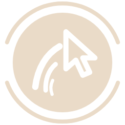
  </picture>
</p>

<h1 align="center">Plume</h1>

<p align="center">Design your own cursor for Omarchy, every cursor drawn to match, and give it trails, halos and colors that follow it live, all from one settings panel.</p>

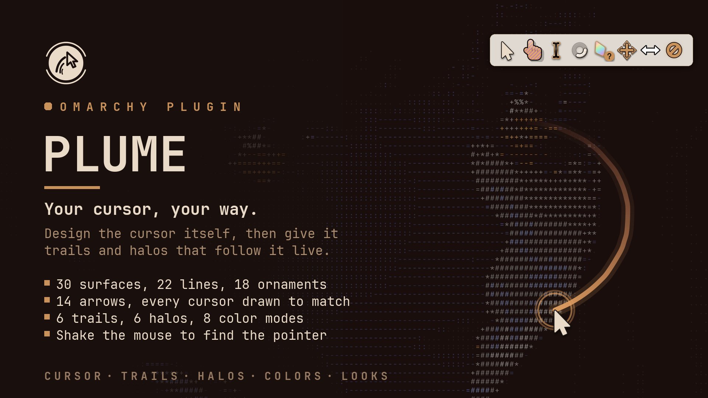

Plume does two things. It makes **the cursor itself**: you pick its arrow, surface, colors, outline and shadow, and Plume draws a whole cursor theme from that, the hand over links, the text beam, the busy spinner and every resize arrow to match, and Hyprland wears it like any other theme. And it draws **effects** around the pointer on a transparent layer above every window; that layer takes no clicks and no keys, so everything under it works as before, and it draws nothing while the pointer rests. A button on the bar turns the effects on and off and opens the settings.

## Features

- **Your own cursor**: 14 arrows, 30 surfaces, solid, gradient or glass fills, 22 lines,
  18 ornaments and 5 shadows, in your theme's colors or your own.
- **Every cursor to match**: the hand, the text beam, an animated busy cursor and every
  resize arrow, worn through Hyprland and as XCursor for GTK and X11 programs.
- **16 ready made cursors** to start from.
- **Trails and halos**: 6 of each, in 8 color modes, drawn on a layer that takes no clicks.
- **Shake to find** the pointer on a big screen.
- **Other cursor themes**, their size, and hiding when idle or while typing.
- **Looks**: 12 ready made, one step of undo, and 12 places of your own.

### Your own cursor

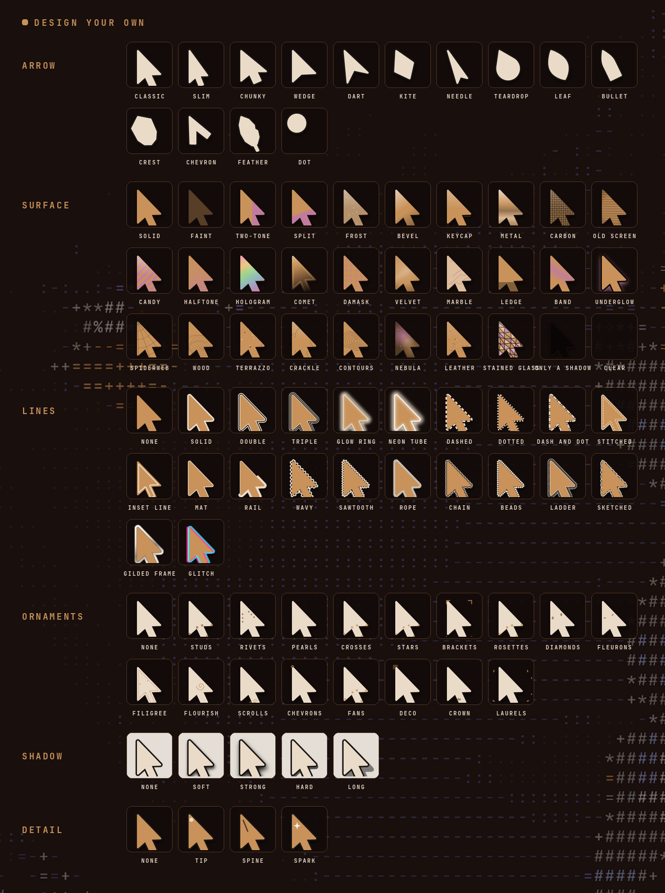

Open **Cursor** in the settings and pick **Made in Plume**. Then make it yours:

- **Arrow**: Classic, Slim, Chunky, Wedge, Dart, Kite, Needle, Teardrop, Leaf, Bullet, Crest, Chevron, Feather or Dot, a **tilt** of up to 30 degrees either way, and **round corners** from sharp to pebbly.
- **Surface**: 30 of them: Solid, Faint, Two-tone, Split, Frost, Bevel, Keycap, Metal, Carbon, Old screen, Candy, Halftone, Hologram, Comet, Damask, Velvet, Marble, Ledge, Band, Underglow, Spiderweb, Wood, Terrazzo, Crackle, Contours, Nebula, Leather, Stained glass, Only a shadow and Clear.
- **Fill**: Solid, Gradient (into the second color, lighter, darker, the accent, the next theme color or the window border; tip to tail, across, diagonal or at the window border's angle) or Glass. Then a **texture** (stripes, dots or a grid), a **depth** (raised or sunken), the **opacity** and an **accent tint**.
- **Colors**: the theme's accent, text or background, your window border's colors, white, black, or your own, for the cursor and a second color. Theme colors follow your Omarchy theme: switch themes and the cursor is made again in the new colors.
- **Lines**: 22 of them: Solid, Double, Triple, Glow ring, Neon tube, Dashed, Dotted, Dash and dot, Stitched, Inset line, Mat, Rail, Wavy, Sawtooth, Rope, Chain, Beads, Ladder, Sketched, Gilded frame and Glitch, or none. Any color (automatic, subtle, or from the list above), four widths, and **gradient lines** that fade into another color in the direction you pick.
- **Ornaments**: 18 of them: Studs, Rivets, Pearls, Crosses, Stars, Brackets, Rosettes, Diamonds, Fleurons, Filigree, Flourish, Scrolls, Chevrons, Fans, Deco, Crown and Laurels, at any size, on the arrow or on every cursor, plus an **accent cap** at the tip, the tail or both, and a **detail**: a dot right where the click lands, a fine spine, or a spark.
- **Shadow**: None, Soft, Strong, Hard or Long, dark or as an accent glow, below or all around, at any strength.
- **The other cursors**: the hand over links (a hand, the arrow with a dot, or a ring), the text cursor (Beam, Slim or Caret) and the busy cursor (Ring, Dots or Orbit, slow, normal or fast).

The top of the tab shows your main cursors on a light and a dark strip as you change them, and with Made in Plume on, the preview at the top of the panel moves your own cursor.

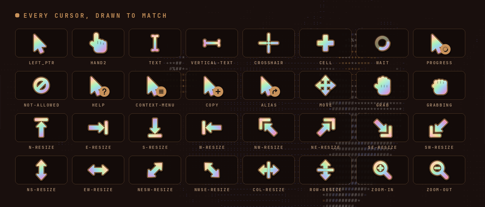

Every cursor programs ask for is there, under all the names they use: the arrow, the hand, text and vertical text, busy and working in the background, help, copy, link, the context menu, not allowed, move, grab and grabbing, every resize arrow, the crosshair, the cell plus, and zoom in and out.

#### Ready made cursors

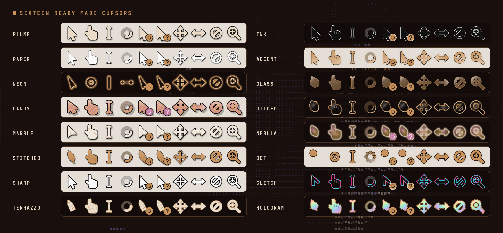

16 cursors to start from, under **Looks › Cursors**: Plume, Ink, Paper, Accent, Neon, Glass, Candy, Gilded, Marble, Nebula, Stitched, Dot, Sharp, Glitch, Terrazzo and Hologram. One click puts the cursor on, looking like that; anything can be changed afterwards, and **Undo** takes it back.

#### How it is worn

Plume writes the cursor as a Hyprcursor theme to `~/.local/share/icons/plume-a` (and `plume-b`; the two take turns, so Hyprland always loads a fresh one) and wears it with `hyprctl setcursor`. The pictures are SVG, so the cursor stays sharp at any size and on any screen scale. Hyprland's own `cursor:enable_hyprcursor` is turned on while you wear it and put back when you stop.

Programs that only know XCursor (GTK 3 ones such as WebKitGTK apps, and X11 ones in XWayland) get the same cursor too: a few seconds after it is worn, `tools/xcursor.py` draws it once more as XCursor into the same folder (with `rsvg-convert`, which comes with Hyprcursor, and `python3`), and Plume sets GTK's cursor theme and size to it with `gsettings`. GTK's own theme and size are remembered and put back when you stop wearing it, and whenever the shell stops. Without `python3` those programs keep showing the theme you had before.

### Trails

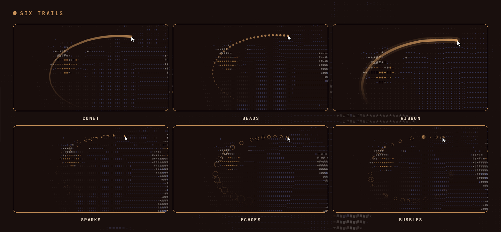

**Comet**, **Beads**, **Ribbon**, **Sparks**, **Echoes** and **Bubbles**, or none. Each one has its length (how long it stays, from 0.15 to 1.5 seconds), its thickness and its strength.

### Halos

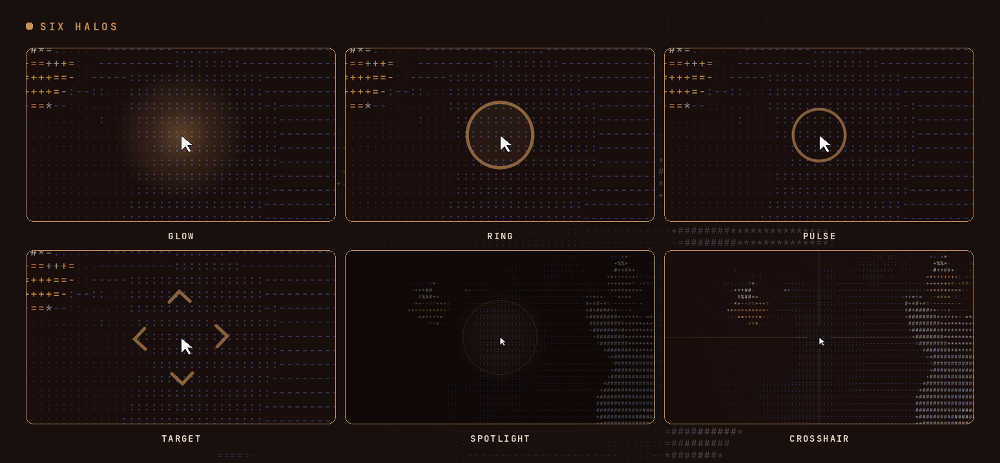

**Glow**, **Ring**, **Pulse**, **Target**, **Spotlight** (dims the screen around the pointer) and **Crosshair** (lines across the whole screen), or none. Each one has its size and strength, and can show always, only while the pointer moves, or only when it rests.

### Colors

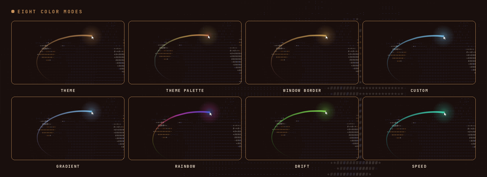

Eight color modes for the trail and the halo together:

- **Theme**: your Omarchy theme's accent, and it changes with the theme.
- **Theme palette**: walks through the theme's colors along the trail.
- **Window border**: the colors of your active window border.
- **Custom** and **Gradient**: one or two colors of your own.
- **Rainbow**, **Drift** (one hue, slowly turning) and **Speed** (cool when slow, hot when fast).

The settings panel has its own colors, under **Colors › This panel**: **Follow theme** matches your Omarchy theme live, **Theme palette** gives every tab its own color from the theme, **Window borders** takes the colors of your active window border, **Custom** uses your own background, text and accent, and **Monochrome** removes every hue. Text can stay always readable, follow the theme, or use your own color. The panel can have an outline in your window border's gradient, at the border's own angle, or in one of its colors, a tint of the accent, and any opacity.

### Shake to find

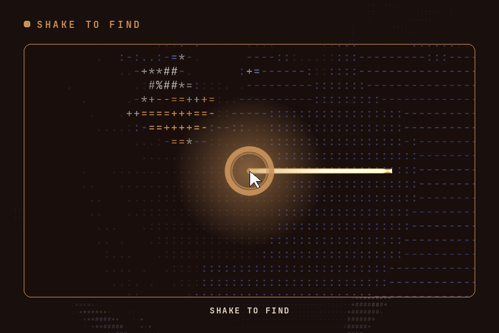

Lost the pointer on a big screen? Shake the mouse left and right and rings rush out of it. The sensitivity and the size of the rings are in **Find**, and `find` does the same from the command line or a key binding.

### Other cursor themes and hiding

**Cursor** also wears any installed theme instead, from `~/.local/share/icons`, `~/.icons` and `/usr/share/icons`, at the size you pick, and sets how the pointer hides:

- **Hide when idle**: never, or after 2, 5, 10 or 30 seconds.
- **Hide while typing**: on or off.

Each one starts at **As Omarchy sets it**, which leaves it alone. Plume remembers what was there before it changed anything and puts it back when you return to that.

### Looks

12 ready made looks set the trail, the halo and the colors in one click: Classic, Neon, Ember, Bubbles, Echo, Beads, Aurora, Drift, Presenter, Crosshair, Target and Minimal. The 16 ready made cursors sit below them. **Undo** takes back the last one.

Below them are 12 places of your own. Each keeps every setting, not only the look: click an empty place to keep everything as it is now, click a full one to go back to it, right click to save over it, middle click to clear it. A look can be copied out as text and pasted back in.

## Installation

```bash
omarchy plugin add https://github.com/qempexe/omarchy-plume.git --enable
omarchy restart shell
```

Then place it from the bar settings, or move it with `omarchy bar move io.github.qempexe.plume --section right` (or `left`, `center`).

It needs Hyprland, which Omarchy already runs. Pasting into a text field goes through `wl-clipboard` (`wl-paste`).

## Usage

### Bar button

A **left click** on the bar button turns the effects on and off, a **right click** opens the settings, a **middle click** finds the pointer, and **scrolling** goes through the ready made looks.

### Command line

```bash
omarchy-shell io.github.qempexe.plume toggle            # effects on or off (also: on, off)
omarchy-shell io.github.qempexe.plume find              # rings around the pointer
omarchy-shell io.github.qempexe.plume look neon         # a ready made look (also: nextLook, undo)
omarchy-shell io.github.qempexe.plume save 3            # keep everything in place 3 (also: saveNew, load 3)
omarchy-shell io.github.qempexe.plume cursor candy      # a ready made cursor, put on
omarchy-shell io.github.qempexe.plume set trail sparks  # any setting
omarchy-shell io.github.qempexe.plume set cursorSurface marble
omarchy-shell io.github.qempexe.plume themes            # the cursor themes it found
omarchy-shell io.github.qempexe.plume status            # what is on, as JSON
omarchy-shell shell toggle io.github.qempexe.plume      # open or close the settings
```

`exportLook` prints the current look as text and `importLook '<text>'` applies one.

To find the pointer with a key, bind `omarchy-shell io.github.qempexe.plume find` in your Hyprland key bindings.

## Configuration

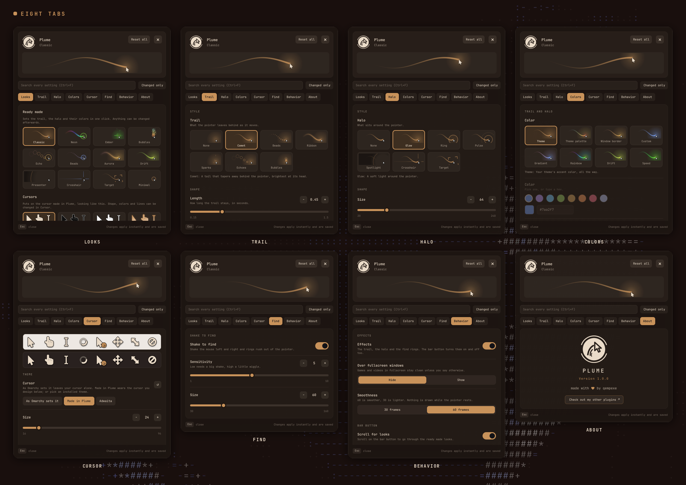

Eight tabs: **Looks**, **Trail**, **Halo**, **Colors**, **Cursor**, **Find**, **Behavior** and **About**. A live preview at the top shows every change as you make it, the search box searches every setting at once, and every changed row has its own arrow back to the default. Everything applies at once and is saved to `~/.local/state/omarchy-plume/settings.json`.

<table>
<tr>
<td>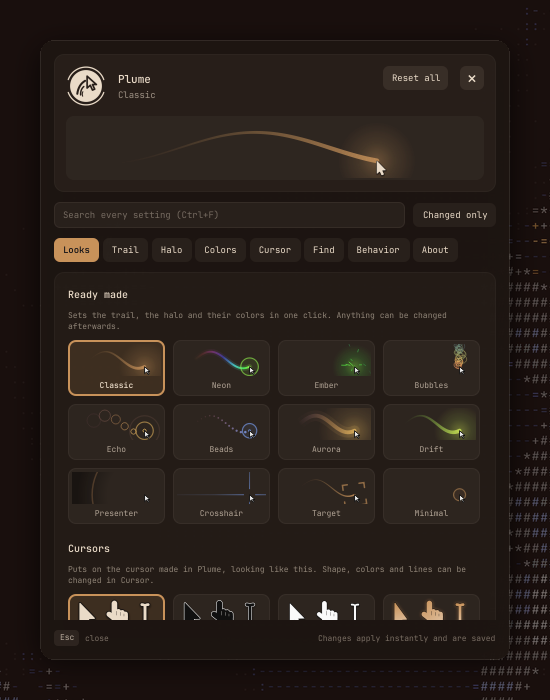</td>
<td>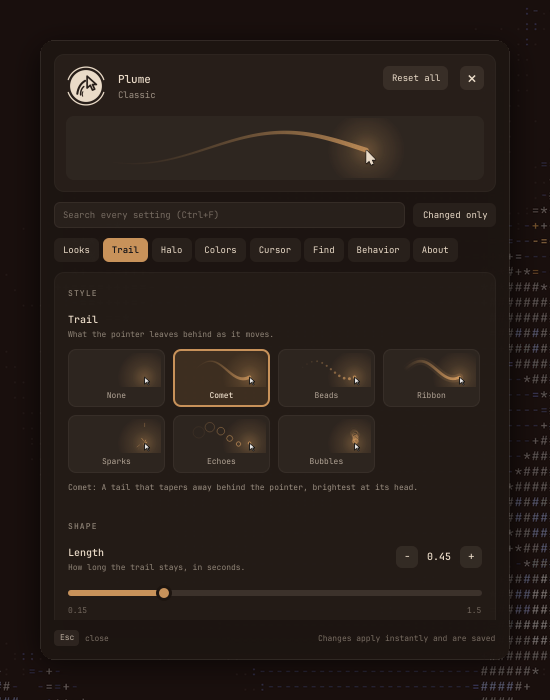</td>
<td>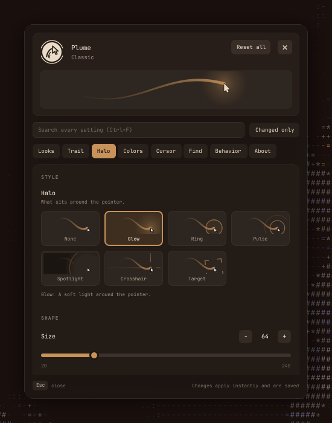</td>
<td>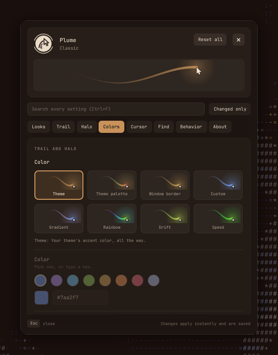</td>
</tr>
<tr>
<td>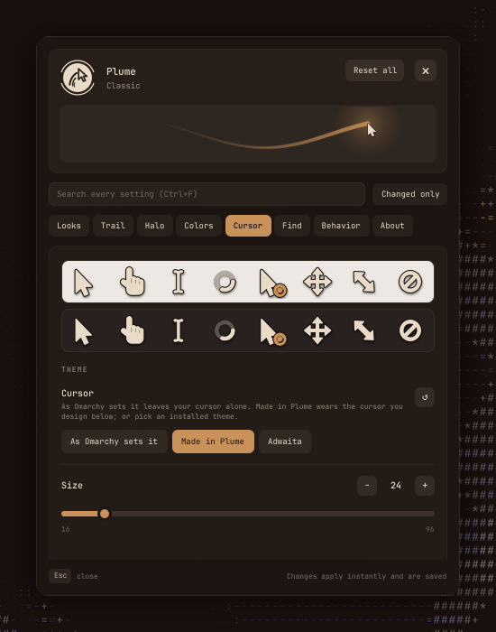</td>
<td>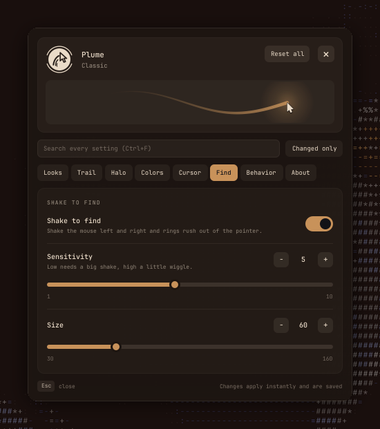</td>
<td>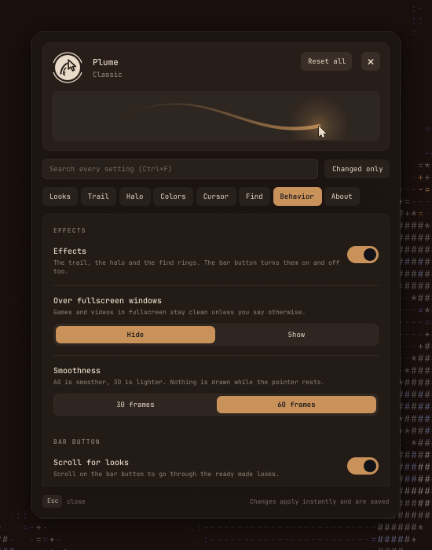</td>
<td>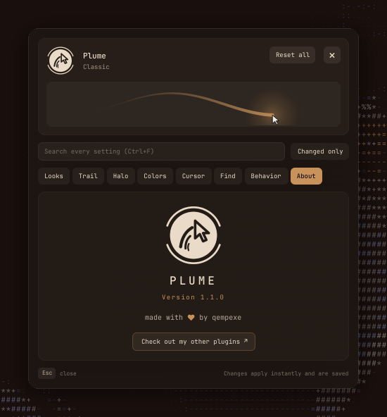</td>
</tr>
</table>

**Behavior** also holds whether the effects show over fullscreen windows (hidden by default, so games and videos stay clean) and the smoothness, 60 or 30 frames a second.

## Troubleshooting

- Where the pointer is comes from Hyprland's own socket, asked once a frame while the pointer moves and a few times a second while it rests. Nothing leaves your computer.
- The effects stop drawing when the pointer rests, and are hidden over fullscreen windows unless you say otherwise.
- The cursor is changed with `hyprctl setcursor` and `hyprctl eval`, only for the settings you change, and only for this session of Hyprland; your config files are never touched.
- The cursor made in Plume is written by the shell itself. Only its XCursor copy is drawn by a program, `tools/xcursor.py` with `rsvg-convert`, and GTK's cursor is set with `gsettings`, for those two keys only. When you stop wearing it, its folders' `manifest.hl` is moved aside to `manifest.hl.off`, so Hyprland never picks it up by itself at the next login.
- Text fields read at most 1 KB from the clipboard, only on Ctrl+V or Shift+Insert.
- The bar button works in the built-in bar and in replacement bars. Where the shell gives a replacement bar's widget no live service, Plume reads a detached snapshot and calls a short list of actions instead; the effects and the cursor are unchanged either way.

## Contributing

Bug reports and ideas are welcome as [issues](https://github.com/qempexe/omarchy-plume/issues).
An arrow, a surface, a line, an ornament, a trail, a halo or a color mode is one small
file or one entry; [CONTRIBUTING.md](CONTRIBUTING.md) explains each and the tests.
Everyone taking part is expected to follow the [code of conduct](CODE_OF_CONDUCT.md).
What changed in each version is in the [changelog](CHANGELOG.md).

### Source layout

```
qml/
├── Service.qml          settings, looks, the pointer from Hyprland, the cursor commands, the cursor made here
├── BarWidget.qml        the bar button
├── overlay/             Overlay (one click-through layer per screen), Effects (the canvas)
├── panel/               SettingsPopup, SettingRow, LooksPage, FxArt (the tiles and preview),
│                        CursorArt, CursorShowcase, AboutPage, ServiceProxy (a replacement bar's view)
├── core/                SettingsStore, Run (helper commands), CursorForge (writes the cursor theme)
└── js/
    ├── arrows/          one file per arrow, listed in Arrows.js
    ├── parts/           Surfaces.js, Lines.js, Ornaments.js: the cursor's styles
    ├── Geo.js           outlines grown, shrunk and walked along (unit-tested)
    ├── Glyphs.js        the shape of every other cursor
    ├── Cursor.js        settings -> a design -> SVG pictures -> a Hyprcursor theme (unit-tested)
    ├── Zip.js           packs each cursor into its .hlc (unit-tested)
    ├── trails/          one file per trail, listed in Trails.js
    ├── halos/           one file per halo, listed in Halos.js
    ├── colors/          one file per color mode, listed in Colors.js
    ├── Motion.js        the pointer's path, speed and shaking (unit-tested)
    ├── Pointer.js       cursor themes and the hyprctl commands (unit-tested)
    ├── Paint.js         draws one frame; Find.js draws the find rings
    ├── Schema.js        every setting and the ready made looks
    ├── BarBridge.js     the detached snapshot and actions a replacement bar's widget can reach
    └── Ink.js, Theme.js, Demo.js
assets/                  the logo, light and dark
tools/manifest.js        writes manifest.json from Schema.js
tools/xcursor.py         draws the XCursor copy of the cursor made in Plume
tests/                   node tests/test_parts.js · node tests/test_cursor.js · node tests/test_motion.js
                         node tests/test_bridge.js · python3 tests/test_manifest.py
                         python3 tests/test_xcursor.py
```

### Upgrading and uninstalling

```bash
omarchy plugin update io.github.qempexe.plume
omarchy restart shell
```

Before removing it, set **Cursor** and the hiding back to *As Omarchy sets it*, or run `hyprctl reload` afterwards, so the cursor goes back to your config.

```bash
omarchy plugin remove io.github.qempexe.plume
rm -rf ~/.local/state/omarchy-plume                          # settings, looks, what the pointer was before
rm -rf ~/.local/share/icons/plume-a ~/.local/share/icons/plume-b   # the cursor made in Plume
```

GTK's cursor theme and size are put back when the shell stops. If they still point at
`plume-a` or `plume-b`, `gsettings reset org.gnome.desktop.interface cursor-theme` and
`gsettings reset org.gnome.desktop.interface cursor-size` set them back to the default.

## License and credits

[MIT](LICENSE).

- Thanks to the **Omarchy** project and the plugin marketplace maintainers for the shell and the catalog.
- Thanks to **Hyprland** for the compositor and its socket, and to **Hyprcursor** for SVG cursor themes.
- Thanks to **Quickshell** and **Qt** for the toolkit.
- Thanks to [keylimesoda](https://github.com/keylimesoda) for replacement bar support and [vanvonlj](https://github.com/vanvonlj) for the XCursor copy.
- Thanks to everyone who tests it and reports issues.

Plume is an independent project, not affiliated with or endorsed by Omarchy or Hyprland.
